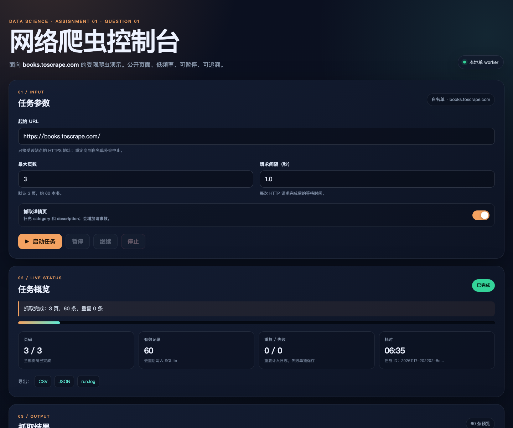

# Data Science

本仓库存放 Data Science 课程作业与复现材料。

## Assignment 01

### Question 01 · 网络爬虫

实现了一个面向 `books.toscrape.com` 的本地 Web 爬虫控制台，支持参数化抓取、暂停/继续/停止、结果预览、失败记录和 CSV/JSON/日志导出。

- [作业说明与运行方式](assignment01/question01/README.md)
- [Web 控制台源码](assignment01/question01/)
- [实际抓取结果 CSV](assignment01/question01/data/demo_books_3pages/result.csv)
- [页面预览](assignment01/question01/preview/console.png)

### Question 02 · 主成分分析（PCA）

完成了一套 18 页 PCA 演示稿，内容包括降维动机、几何直觉、最大方差目标、特征值推导、SVD 与 PCA 的关系、主成分数量选择、完整流程，以及 UCI Wine 的 13 维到 3 维案例。

- [作业说明与复现方式](assignment01/question02/README.md)
- [PDF 演示稿](assignment01/question02/dist/assignment01-question02-pca.pdf)
- [直接打开/下载 PDF（jsDelivr）](https://cdn.jsdelivr.net/gh/yuwen-xiao/Data-Science@main/assignment01/question02/dist/assignment01-question02-pca.pdf)
- [Web 幻灯片](assignment01/question02/dist/index.html)
- [Markdown 源文件](assignment01/question02/slide.md)
- [UCI Wine 数据](assignment01/question02/data/wine.data)
