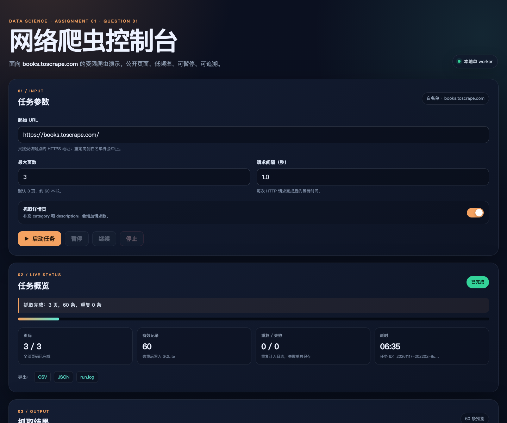
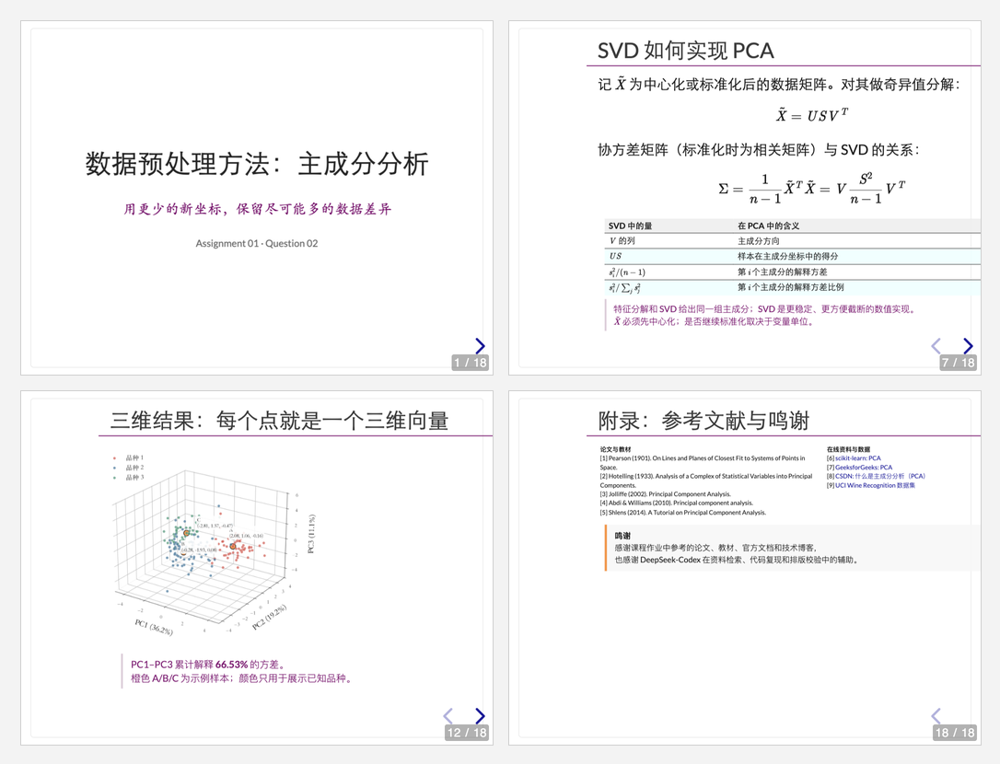

# Assignment 01

## 效果预览

<table>
<tr>
<td width="50%" valign="top">

<b>Question 01 · 网络爬虫控制台</b> 参数化抓取、暂停/继续/停止、结果预览和 CSV/JSON/日志导出。

</td>
<td width="50%" valign="top">

<b>Question 02 · PCA 演示稿</b> 18 页 Web/PDF 幻灯片，包含 SVD 与 PCA 的关系、Wine 三维案例和参考文献。

</td>
</tr>
</table>

## Question 01 · 网络爬虫

- [实现说明、运行步骤与结果](question01/README.md)
- [实际结果 CSV](question01/data/demo_books_3pages/result.csv)
- [实际结果 JSON](question01/data/demo_books_3pages/result.json)
- [运行日志](question01/data/demo_books_3pages/run.log)

目标站点：`https://books.toscrape.com/`。实际抓取 3 个列表页，得到 60 条有效记录，无重复、无失败。

## Question 02 · 主成分分析（PCA）

18 页 Web/PDF 演示稿，围绕降维目标、最大方差、特征分解、SVD 数值实现、主成分数量选择和 UCI Wine 案例展开。

- [实现说明与复现方式](question02/README.md)
- [PDF 演示稿](question02/dist/assignment01-question02-pca.pdf)
- [直接打开/下载 PDF（jsDelivr）](https://cdn.jsdelivr.net/gh/yuwen-xiao/Data-Science@main/assignment01/question02/dist/assignment01-question02-pca.pdf)
- [Web 幻灯片](question02/dist/index.html)
- [Markdown 源文件](question02/slide.md)
