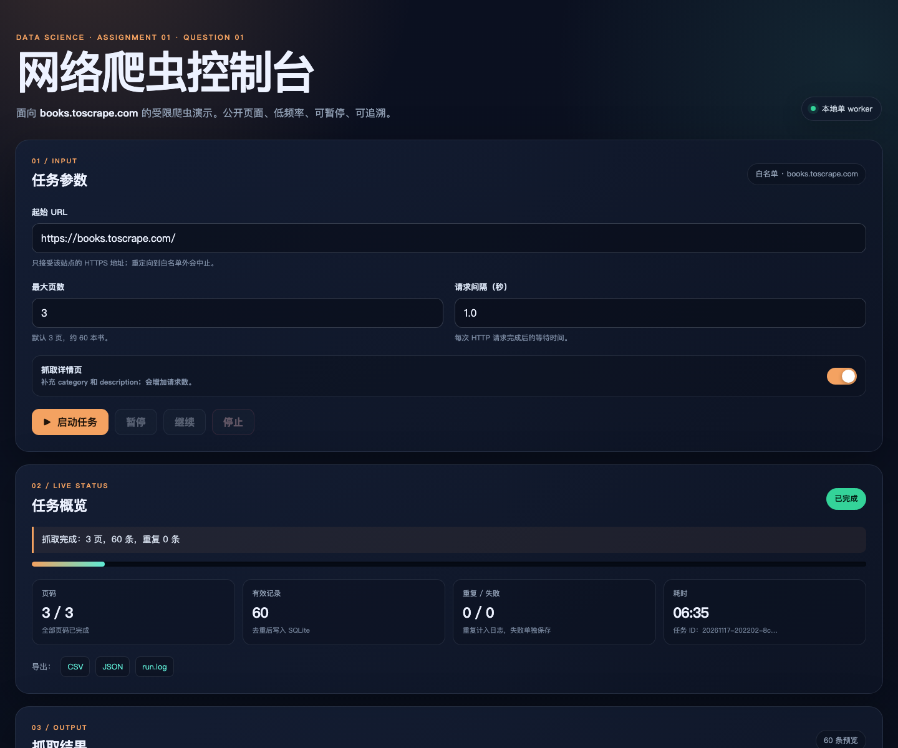

# Assignment 01 · Question 01 网络爬虫

## 1. 目标

实现一个本地单页 Web 爬虫控制台，对公开爬虫练习站
[`books.toscrape.com`](https://books.toscrape.com/) 发起受限、低速、可暂停的抓取，
并展示和导出结构化结果。

系统只面向作业演示，不是通用爬虫平台，也不与目标站点的风控机制对抗。

## 2. 功能

- 输入起始 URL、最大页数、请求间隔、是否抓取详情页。
- 启动、暂停、继续、停止；单任务单 worker。
- 域名白名单、HTTPS 校验、重定向校验。
- 抓取以下字段：
  `title`、`price`、`price_gbp`、`rating`、`availability`、`category`、
  `detail_url`、`description`、`source_page`、`scraped_at`、`quality_flags`。
- 通过 `UNIQUE(job_id, detail_url)` 去重。
- 关键字段校验、质量提示、失败记录与运行日志。
- 网页实时展示进度、日志、结果预览和失败记录。
- 下载 CSV、JSON、run.log。
- 检测 403、429、验证码/人机验证特征；首次检测后安全暂停，不自动破解。
  同一资源连续被拦截 3 次则任务失败。

## 3. 运行

```bash
git clone https://github.com/yuwen-xiao/Data-Science.git
cd Data-Science/assignment01/question01
python3 -m venv .venv
.venv/bin/pip install -r requirements.txt
.venv/bin/uvicorn app.main:app --host 127.0.0.1 --port 8000
```

浏览器打开 <http://127.0.0.1:8000/>。

命令行实跑与导出：

```bash
.venv/bin/python -m app.cli \
  --pages 3 \
  --interval 1.0 \
  --export-dir data/demo_books_3pages
```

也可以使用：

```bash
./scripts/run_demo.sh
```

> 同一个 SQLite 状态库只应运行一个控制台或命令行任务。启动新进程时，上一进程遗留的
> 未完成任务会被标记为“服务重启失败”，避免伪造仍在运行的状态。

## 4. 测试

```bash
.venv/bin/python -m unittest discover -s tests -v
```

测试覆盖 URL 白名单与协议、参数边界、列表/详情解析、反爬特征检测、
SQLite 写入与去重、失败计数。

## 5. 架构

```text
浏览器原生 HTML/CSS/JS
        │ JSON API + 1s 轮询
        ▼
FastAPI（app/main.py）
        │
        ▼
CrawlManager（app/crawler.py）
        │ 单后台线程
        ├── requests + BeautifulSoup/lxml
        ├── 安全暂停 / 停止控制
        ├── SQLite：jobs / items / failures / logs
        └── raw HTML 快照
```

目录：

```text
question01/
├── app/
│   ├── main.py          # FastAPI 路由与下载接口
│   ├── crawler.py       # 采集、校验、SQLite、导出
│   └── cli.py           # 命令行实跑
├── static/
│   ├── index.html
│   ├── styles.css
│   └── app.js
├── tests/test_core.py
├── scripts/run_demo.sh
├── data/
│   ├── runtime/           # 运行时生成，不提交：数据库、原始 HTML
│   └── demo_books_3pages/ # 实跑后的 CSV/JSON/日志
├── preview/console.png    # 页面预览
├── requirements.txt
└── README.md
```

`data/runtime/`、`.venv/`、`__pycache__/` 和临时数据库均被 `.gitignore` 排除。
运行时会自动创建 `data/runtime/`；仓库只保留可复现的源代码与最终实跑结果。

## 6. 允许与不允许

允许：

- 抓取白名单站点公开页面；
- 调整页数、间隔、详情页开关；
- 暂停、继续、停止任务；
- 查看、下载结构化结果与日志。

不允许：

- 任意域名、内网地址、非 HTTPS 地址；
- 登录凭据、短信验证码、个人隐私数据；
- 自定义脚本上传或任意代码执行；
- 代理池、账号池、绕过频率限制；
- 自动破解滑块、行为验证或复杂验证码。

## 7. 处理流程

1. 校验参数和域名白名单。
2. 创建任务并启动唯一 worker。
3. 请求列表页，保存原始 HTML。
4. 解析书名、价格、评分、库存和详情链接。
5. 可选请求详情页，补充分类和简介。
6. 字段校验；重复链接跳过；失败写入 `failures`。
7. 解析下一页并继续，直到页数上限或无下一页。
8. 页面实时轮询状态、日志和预览。
9. 从 SQLite 导出 CSV、JSON、日志和失败记录。

## 8. 已知边界

- 仅适配 `books.toscrape.com` 当前静态 HTML 结构，不是通用选择器系统。
- 不支持 JavaScript 动态渲染；该目标站不需要 Playwright。
- 不处理登录、复杂验证码、代理轮换、分布式并发。
- 暂停发生在请求或记录处理的安全点，不是强制中断 socket。
- 详情页失败时会保留列表页数据，并记录失败和质量提示。
- 价格以页面展示的 GBP 文本为准；`price_gbp` 是辅助数值字段。
- 控制台为本地单用户工具，无账号、权限和公网部署加固。

## 9. 实跑结果

2026-11-17 使用请求间隔 1 秒、开启详情页实际运行：

| 项目 | 结果 |
|---|---:|
| 任务 ID | `20261117-190956-43ec7244` |
| 列表页 | 3 / 3 |
| 有效记录 | 60 |
| 重复记录 | 0 |
| 失败记录 | 0 |
| 原始 HTML 快照 | 63 |
| 七项核心字段缺失 | 0 |
| 运行耗时 | 4 分 22 秒 |
| 状态 | completed |

真实结果保存在：

```text
data/demo_books_3pages/result.csv
data/demo_books_3pages/result.json
data/demo_books_3pages/run.log
data/demo_books_3pages/failures.json
data/demo_books_3pages/summary.json
```

页面预览：



验证结果：

- 7 项单元测试全部通过。
- CSV 60 行、60 个唯一详情 URL；title、price、rating、availability、
  category、detail_url、description 均无缺失。
- 价格字符集修复后统一为 `£`，无 `£` 乱码。
- API 首页、状态、预览和 CSV/JSON/run.log 下载均返回 HTTP 200。
- 非法域名和非法页数被 HTTP 422 拒绝。
- 浏览器桌面端 60 行、72 条日志、失败列表为空，无 JavaScript/控制台错误。
- 390px 移动端无横向溢出；参数表单为单列布局。
- 隔离临时库中的真实网络任务完成“暂停 → 继续 → 停止”状态测试。
