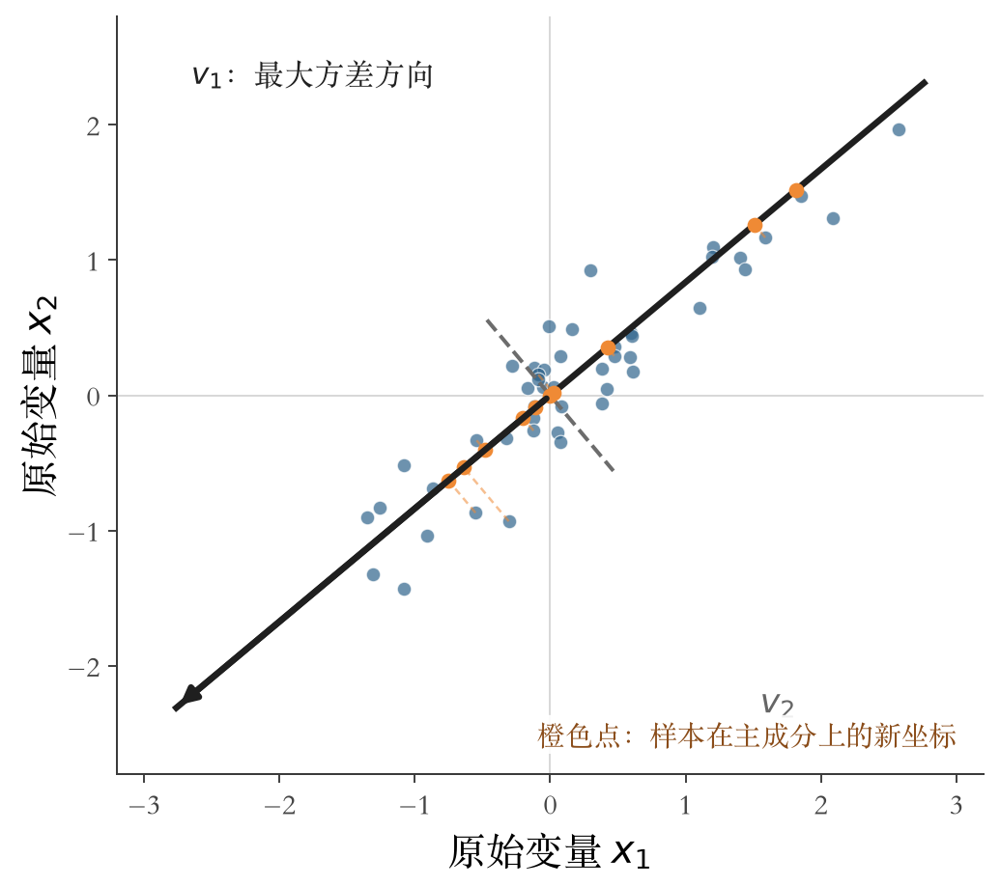
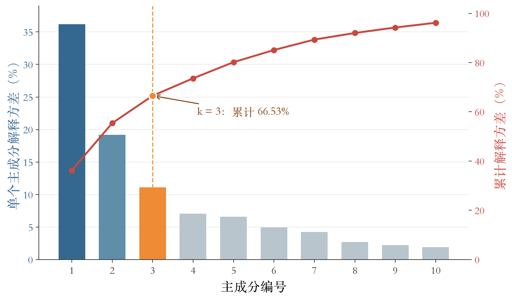
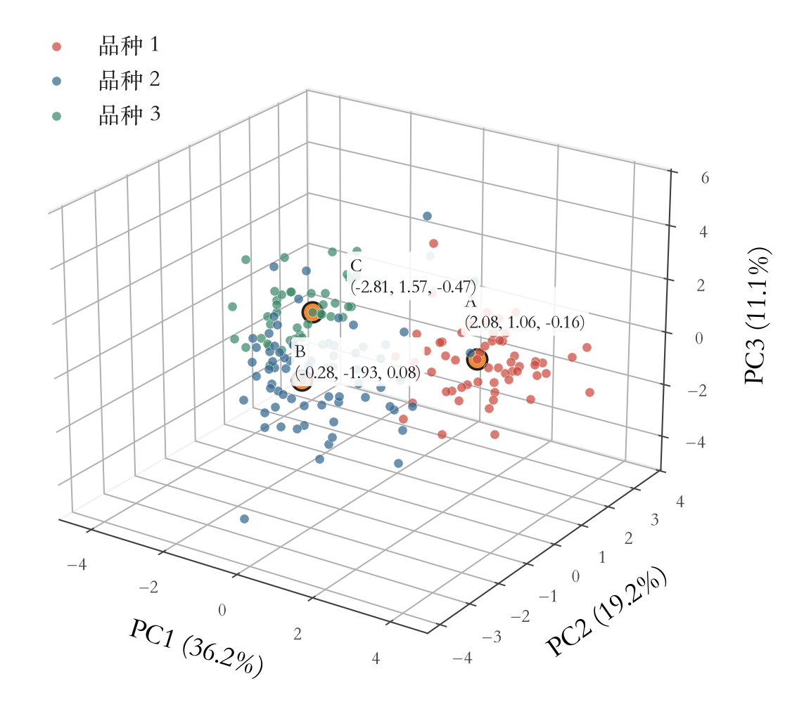

# 数据预处理方法：主成分分析

> 用更少的新坐标，保留尽可能多的数据差异

Assignment 01 · Question 02

---

## 介绍思路

1. 为什么需要降维
2. PCA 的几何直觉
3. 最大方差与特征值
4. SVD 如何实现 PCA
5. 如何选择主成分数量
6. 完整 PCA 流程
7. Wine 数据：13 维 → 3 维
8. 应用、边界与结论

先建立直觉，再把直觉写成公式，最后用真实数据验证。

---

## 为什么需要 PCA

- **维度高**：计算更慢，样本更难可视化
- **变量相关**：多个特征在重复表达同一类信息
- **噪声存在**：并非所有变化都值得保留
- **难以整体观察**：13 个变量很难在一张图里同时可视化

PCA 的目标：

用少数几个互不相关的新变量，尽量保留原始数据中的主要变化。

它不是“随便删掉几列”，而是构造原始变量的线性组合。

---

## 几何直觉：寻找方差最大的方向

二维点云投影到 $v_1$：投影后的点尽可能分散；$v_2$ 与 $v_1$ 正交。

---

## 从“分散”到“最大方差”

记预处理后的样本为 $\tilde x_i$（中心化或标准化），单位方向为 $w$。
一维投影得分为：

$$
t_i=w^T\tilde x_i
$$

投影后的方差：

$$
\operatorname{Var}(t)=\frac{1}{n-1}\sum_{i=1}^{n}(t_i-\bar t)^2
=w^T\Sigma w
$$

其中 $\Sigma$ 是协方差矩阵。于是：

$$
\max_w\ w^T\Sigma w
\qquad \text{s.t.}\qquad \|w\|_2=1
$$

PCA 的第一主成分，就是让投影后方差最大的单位方向。 中心化是必要预处理；若做标准化，$\tilde x_i=D_\sigma^{-1}(x_i-\mu)$，其中 $D_\sigma=\operatorname{diag}(\sigma_1,\ldots,\sigma_p)$。

---

## 为什么答案一定是特征向量

构造拉格朗日函数：

$$
\mathcal L(w,\lambda)=w^T\Sigma w-\lambda(w^Tw-1)
$$

对 $w$ 求导并令其为零：

$$
\Sigma w=\lambda w
$$

因此：

- $w$：协方差矩阵的特征向量，也就是主成分方向
- $\lambda$：该方向上的解释方差
- 按 $\lambda_1\ge\lambda_2\ge\cdots$ 排序
- 前 $k$ 个特征向量组成降维矩阵 $W_k$

下一步需要回答：这些特征向量应该怎样稳定、高效地计算？

---

## SVD 如何实现 PCA

记 $\tilde X$ 为中心化或标准化后的数据矩阵。对其做奇异值分解：

$$
\tilde X=USV^T
$$

协方差矩阵（标准化时为相关矩阵）与 SVD 的关系：

$$
\Sigma=\frac{1}{n-1}\tilde X^T\tilde X
=V\frac{S^2}{n-1}V^T
$$

<table style="width:92%; margin:8px auto; font-size:19px; table-layout:fixed">
<colgroup><col style="width:31%"><col style="width:69%"></colgroup>
<thead><tr><th>SVD 中的量</th><th>在 PCA 中的含义</th></tr></thead>
<tbody>
<tr><td>$V$ 的列</td><td>主成分方向</td></tr>
<tr><td>$US$</td><td>样本在主成分坐标中的得分</td></tr>
<tr><td>$s_i^2/(n-1)$</td><td>第 $i$ 个主成分的解释方差</td></tr>
<tr><td>$s_i^2/\sum_j s_j^2$</td><td>第 $i$ 个主成分的解释方差比例</td></tr>
</tbody>
</table>

特征分解和 SVD 给出同一组主成分；SVD 是更稳定、更方便截断的数值实现。 $\tilde X$ 必须先中心化；是否继续标准化取决于变量单位。

---

## 如何选择主成分数量

SVD 给出全部主成分；下一步决定保留前几个。

判断标准：累计解释方差、重构误差，以及下游分类/聚类/回归效果。

三维图只是可视化选择，不代表 $k=3$ 就是最佳降维维度。

---

## 完整 PCA 流程

1. 选择数值型特征并处理缺失值
2. 中心化，必要时标准化
3. 计算协方差矩阵特征分解，或直接做 SVD
4. 计算解释方差和累计解释方差
5. 选择前 $k$ 个主成分
6. 计算主成分得分或重构数据
7. 用重构误差和下游任务验证效果

第 5 步的判据已在上一页展开。

标准化不是“必选项”：它取决于变量单位与任务。 关键是记录并解释你的选择。

补充参考：<a href="https://blog.csdn.net/qq_54700138/article/details/146046975">什么是主成分分析（PCA）——从零开始讲清楚（CSDN）</a>

---

## Wine 实例：数据与设置

- 数据集：[UCI Wine Recognition](https://archive.ics.uci.edu/dataset/109/wine)
- 样本：178 个；原始特征：13 个
- 类别：3 个葡萄品种（仅用于着色的结果解释）
- 预处理：13 个特征分别做 Z-score 标准化
- 方法：SVD 形式 PCA
- 可视化：保留前三个主成分

| 主成分 | 解释方差比例 | 累计解释方差 |
|---|---:|---:|
| PC1 | 36.20% | 36.20% |
| PC2 | 19.21% | 55.41% |
| PC3 | 11.12% | **66.53%** |

---

## 从 13 维向量到 3 维向量

<b>A（样本 20，品种 1）</b> 
$x_A=(13.64,3.10,2.56,\ldots,845.00)\in\mathbb R^{13}$ 
$\tilde x_A=D_\sigma^{-1}(x_A-\mu)$ 
$t_A=W_3^T\tilde x_A=(2.0845,\ 1.0611,\ -0.1647)$

<table style="width:94%; margin:10px auto; font-size:22px">
<thead><tr><th>样本</th><th style="text-align:right">原始维度</th><th>三维得分 $t_A=(PC_1,PC_2,PC_3)$</th></tr></thead>
<tbody>
<tr><td>A · 样本 20</td><td style="text-align:right">13</td><td>$(2.0845,\ 1.0611,\ -0.1647)$</td></tr>
<tr><td>B · 样本 112</td><td style="text-align:right">13</td><td>$(-0.2787,\ -1.9306,\ 0.0787)$</td></tr>
<tr><td>C · 样本 149</td><td style="text-align:right">13</td><td>$(-2.8071,\ 1.5705,\ -0.4725)$</td></tr>
</tbody>
</table>

A、B、C 分别取三类在三维得分空间中最接近类别中心的样本；完整 13 维数据见 `data/wine.data`。

---

## 三维结果：每个点就是一个三维向量

PC1–PC3 累计解释 <b>66.53%</b> 的方差。 橙色 A/B/C 为示例样本；颜色只用于展示已知品种。

---

## 怎样解释前三个主成分

<table style="width:90%; margin:12px auto; font-size:22px; table-layout:fixed">
<colgroup><col style="width:14%"><col style="width:86%"></colgroup>
<thead><tr><th>主成分</th><th>主要方向权重与一种可能解释</th></tr></thead>
<tbody>
<tr><td>PC1</td><td>Flavanoids $+0.423$、Total phenols $+0.395$ 解释：酚类/黄酮类轴</td></tr>
<tr><td>PC2</td><td>Color intensity $+0.530$、Alcohol $+0.484$ 解释：颜色—酒精轴</td></tr>
<tr><td>PC3</td><td>Ash $+0.626$、Alcalinity of ash $+0.612$ 解释：灰分—碱度轴</td></tr>
</tbody>
</table>

这里的<b>载荷</b>指主成分方向中对应原始变量的系数；<b>得分</b>表示样本在新坐标中的位置。 主成分的正负号可以整体翻转；完整载荷见 <code>pca_metrics.json</code>。

---

## 降维不是无损压缩

先在标准化空间中重构，再换回原始尺度：

$$
\hat{\tilde{x}}_{i}=W_3t_{i},\qquad
\hat{x}_{i}=\mu+D_{\sigma}\hat{\tilde{x}}_{i}
$$

在本次 Wine 例子中：

- 前三个主成分保留 **66.53%** 的方差
- 仍有 **33.47%** 的方差未进入三维表示
- 因此，三维图适合观察结构，但不能替代全部 13 维特征

$k$ 的选择应该由“要保留多少方差”和“下游任务是否变差”共同决定。

---

## PCA 的典型应用

<table style="width:86%; margin:16px auto; font-size:19px; line-height:1.4; table-layout:fixed; border-collapse:collapse">
<colgroup><col style="width:50%"><col style="width:50%"></colgroup>
<tbody>
<tr>
<td style="padding:14px 16px; background:#f7f7f7; border-left:5px solid #ef8a35"><b>可视化与探索</b> 把高维样本投到二维或三维观察结构。</td>
<td style="padding:14px 16px; background:#f7f7f7; border-left:5px solid #ef8a35"><b>压缩与加速</b> 减少存储量和计算成本。</td>
</tr>
<tr>
<td style="padding:14px 16px; background:#f7f7f7; border-left:5px solid #ef8a35"><b>去噪与共线性</b> 丢弃小方差方向，构造互不相关的新变量。</td>
<td style="padding:14px 16px; background:#f7f7f7; border-left:5px solid #ef8a35"><b>异常与过程监控</b> 观察样本在主成分空间中的偏离程度。</td>
</tr>
</tbody>
</table>

PCA 是线性表示方法，不会自动理解业务含义。

---

## 常见误区与适用边界

- PCA 是**线性、无监督**方法，不保证类别可分
- 是否标准化会改变结果， 量纲大的变量更容易主导方差
- 解释方差高不等于预测效果好
- 异常值可能主导主成分，主成分符号也可以整体翻转
- 三维图看起来分开，不代表模型一定有效

---

## 结论

1. **目标**：寻找正交方向，使投影方差尽可能大。
2. **理论解**：主成分方向是协方差矩阵的特征向量。
3. **数值解**：SVD 给出同一组主成分，数值上更稳定。
4. **案例**：Wine 从 13 维降到 3 维，保留 66.53% 方差。
5. **评价**：结合解释方差、重构误差和下游任务， 判断降维是否有效。

---

## 附录：参考文献与鸣谢

<b>论文与教材</b> 
[1] Pearson (1901). On Lines and Planes of Closest Fit to Systems of Points in Space. 
[2] Hotelling (1933). Analysis of a Complex of Statistical Variables into Principal Components. 
[3] Jolliffe (2002). Principal Component Analysis. 
[4] Abdi &amp; Williams (2010). Principal component analysis. 
[5] Shlens (2014). A Tutorial on Principal Component Analysis.

<b>在线资料与数据</b> 
[6] <a href="https://scikit-learn.org/stable/modules/decomposition.html#pca">scikit-learn: PCA</a> 
[7] <a href="https://www.geeksforgeeks.org/data-analysis/principal-component-analysis-pca/">GeeksforGeeks: PCA</a> 
[8] <a href="https://blog.csdn.net/qq_54700138/article/details/146046975">CSDN: 什么是主成分分析（PCA）</a> 
[9] <a href="https://archive.ics.uci.edu/dataset/109/wine">UCI Wine Recognition 数据集</a>

<b>鸣谢</b> 
感谢课程作业中参考的论文、教材、官方文档和技术博客， 
也感谢 DeepSeek-Codex 在资料检索、代码复现和排版校验中的辅助。

